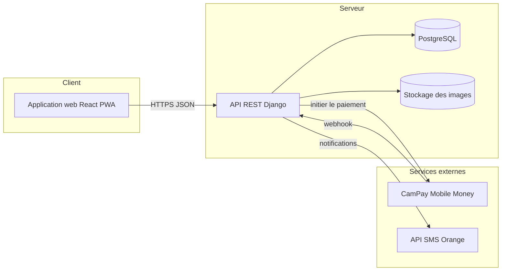
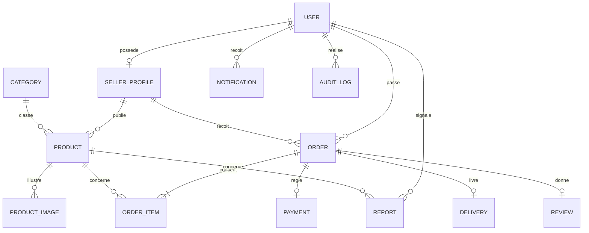
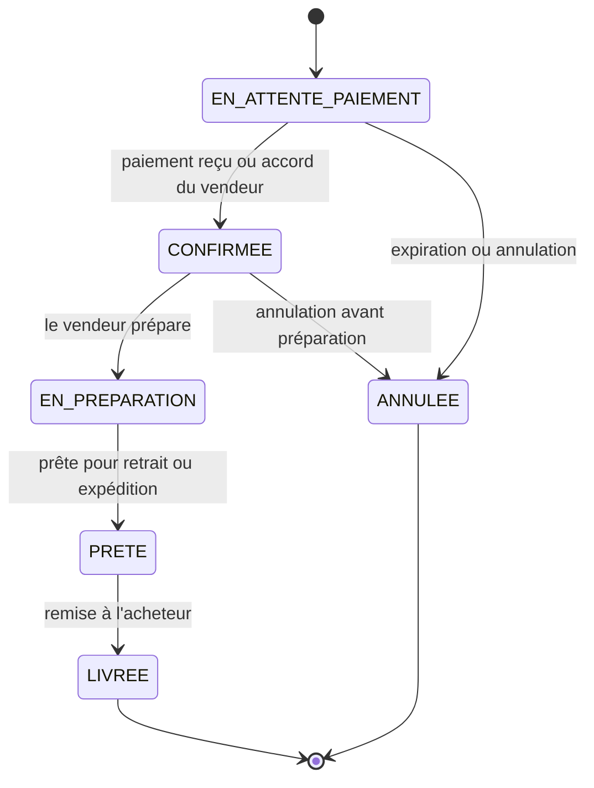
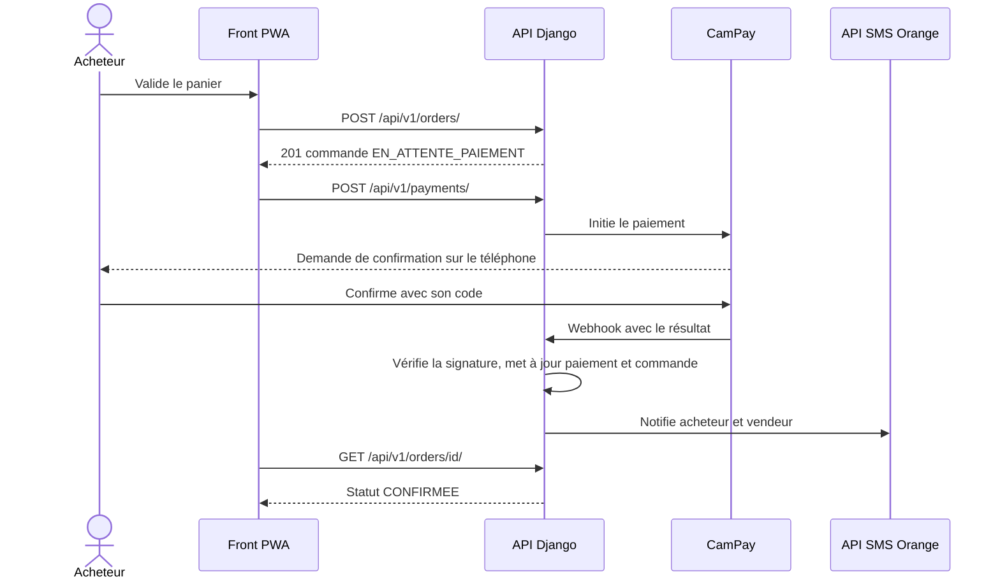
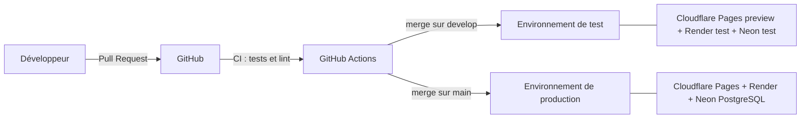

# 🏗️ Architecture du projet

## 1. Vue d'ensemble

L'application suit une architecture **client-serveur** : une application web React (PWA) consomme une API REST Django, adossée à PostgreSQL. Le paiement et les notifications passent par des services externes.



## 2. Architecture logique du back-end

Le back-end est découpé en **applications Django** à responsabilité unique. Les vues restent fines : la logique métier est placée dans des fonctions de service (`services.py`).

| Application | Responsabilité |
|-------------|----------------|
| `accounts` | Utilisateurs, rôles, profils acheteur et vendeur, authentification |
| `catalog` | Catégories, produits, images, recherche et filtres, prix du marché (optionnel) |
| `orders` | Commandes, lignes de commande, statuts, stock, reçu PDF |
| `payments` | Paiements Mobile Money, webhooks, remboursements, commission |
| `deliveries` | Options retrait ou livraison, zones et frais |
| `reviews` | Avis et notes des vendeurs |
| `notifications` | Notifications in-app et SMS (driver Orange) |
| `dashboard` | Statistiques vendeur, alertes de stock, export |
| `moderation` | Validation des vendeurs, signalements, journal d'audit |
| `common` | Permissions, pagination, gestion des erreurs, utilitaires |

Chaque application contient : `models.py`, `serializers.py`, `views.py`, `urls.py`, `services.py`, `permissions.py` (si besoin), `tests/`.

## 3. Modèle de données



### Description des entités

| Entité | Champs principaux |
|--------|-------------------|
| **User** | id, téléphone (unique), email (optionnel), mot de passe (haché), prénom, nom, rôle (`buyer`, `seller`, `admin`), actif, date de création |
| **SellerProfile** | utilisateur, nom d'exploitation, type (`individual`, `gic`, `cooperative`), localité, description, statut (`pending`, `approved`, `rejected`, `suspended`), date de validation |
| **Category** | nom, slug, parent (optionnel), type (`agriculture`, `livestock`) |
| **Product** | vendeur, catégorie, nom, description, prix, unité (`kg`, `piece`, `lot`), quantité disponible, localité, disponible jusqu'au, actif, masqué, dates |
| **ProductImage** | produit, image, ordre |
| **Order** | acheteur, vendeur, statut, total, mode (`pickup`, `delivery`), méthode de paiement (`mobile_money`, `cash_on_delivery`), adresse de livraison, dates |
| **OrderItem** | commande, produit, quantité, prix unitaire au moment de la commande |
| **Payment** | commande, prestataire, opérateur (`mtn`, `orange`), téléphone payeur, montant, commission, statut (`pending`, `success`, `failed`, `refunded`), référence externe, charge utile brute |
| **Delivery** | commande, zone, frais, adresse, statut, date estimée |
| **Review** | commande, acheteur, vendeur, note (1 à 5), commentaire, date |
| **Notification** | utilisateur, canal (`in_app`, `sms`, `whatsapp`), type, message, lue, date d'envoi |
| **Report** | auteur, produit ou vendeur concerné, motif, statut (`open`, `resolved`), résolution |
| **AuditLog** | auteur, action, cible, détails, date |
| **MarketPrice** (optionnel) | produit de référence, prix moyen, localité, date |

### Règles structurantes

- Une **commande concerne un seul vendeur**. Un panier multi-vendeurs génère plusieurs commandes.
- Le prix unitaire est **copié dans la ligne de commande** pour conserver l'historique.
- Le stock est **décrémenté dans une transaction atomique** à la création de la commande, et restitué en cas d'annulation ou d'expiration du paiement.
- Les paiements sont **idempotents** : une même notification du prestataire ne doit pas être traitée deux fois.

## 4. Cycle de vie d'une commande



## 5. Flux de paiement Mobile Money



## 6. API REST

Préfixe : `/api/v1/`. Format : JSON. Authentification : en-tête `Authorization: Bearer <access_token>`. Pagination par défaut sur les listes. Documentation interactive : `/api/docs/` (Swagger), schéma : `/api/schema/`.

| Module | Méthode | Route | Description | Accès |
|--------|---------|-------|-------------|-------|
| Auth | POST | `/auth/register/` | Créer un compte | Public |
| Auth | POST | `/auth/login/` | Obtenir les jetons | Public |
| Auth | POST | `/auth/refresh/` | Rafraîchir le jeton d'accès | Public |
| Auth | POST | `/auth/logout/` | Invalider le jeton de rafraîchissement | Connecté |
| Auth | POST | `/auth/password-reset/` | Demander la réinitialisation | Public |
| Profils | GET, PATCH | `/users/me/` | Consulter ou modifier son profil | Connecté |
| Profils | GET, PATCH | `/sellers/me/` | Profil vendeur | Vendeur |
| Profils | GET | `/sellers/{id}/` | Profil public d'un vendeur | Public |
| Catalogue | GET | `/categories/` | Lister les catégories | Public |
| Catalogue | GET | `/products/` | Lister avec recherche, filtres, tri, pagination | Public |
| Catalogue | POST | `/products/` | Publier un produit | Vendeur validé |
| Catalogue | GET | `/products/{id}/` | Détail d'un produit | Public |
| Catalogue | PATCH, DELETE | `/products/{id}/` | Modifier ou supprimer | Vendeur propriétaire |
| Catalogue | POST, DELETE | `/products/{id}/images/` | Ajouter ou retirer une photo | Vendeur propriétaire |
| Catalogue | GET | `/sellers/me/products/` | Mes produits | Vendeur |
| Catalogue | GET | `/market-prices/` | Prix du marché (optionnel) | Public |
| Commandes | POST | `/orders/` | Créer une commande | Acheteur |
| Commandes | GET | `/orders/` | Mes commandes (acheteur ou vendeur) | Connecté |
| Commandes | GET | `/orders/{id}/` | Détail et suivi | Acheteur ou vendeur concerné |
| Commandes | POST | `/orders/{id}/cancel/` | Annuler | Acheteur ou vendeur concerné |
| Commandes | POST | `/orders/{id}/prepare/` | Passer en préparation | Vendeur |
| Commandes | POST | `/orders/{id}/ready/` | Marquer prête | Vendeur |
| Commandes | POST | `/orders/{id}/deliver/` | Marquer livrée | Vendeur |
| Commandes | GET | `/orders/{id}/receipt/` | Reçu PDF | Acheteur ou vendeur concerné |
| Livraison | GET | `/delivery-zones/` | Zones et frais | Public |
| Livraison | GET, PATCH | `/orders/{id}/delivery/` | Consulter ou mettre à jour | Concerné |
| Paiement | POST | `/payments/` | Initier un paiement | Acheteur |
| Paiement | GET | `/payments/{id}/` | Statut du paiement | Acheteur ou vendeur concerné |
| Paiement | POST | `/payments/webhook/{provider}/` | Réception du résultat | Prestataire (signature vérifiée) |
| Paiement | POST | `/payments/{id}/refund/` | Rembourser | Administrateur |
| Avis | POST | `/orders/{id}/review/` | Noter après livraison | Acheteur |
| Avis | GET | `/sellers/{id}/reviews/` | Avis d'un vendeur | Public |
| Notifications | GET | `/notifications/` | Mes notifications | Connecté |
| Notifications | POST | `/notifications/{id}/read/` | Marquer comme lue | Connecté |
| Tableau de bord | GET | `/seller/dashboard/summary/` | Résumé | Vendeur |
| Tableau de bord | GET | `/seller/dashboard/sales/` | Ventes par période et par produit | Vendeur |
| Tableau de bord | GET | `/seller/dashboard/low-stock/` | Produits à stock bas | Vendeur |
| Tableau de bord | GET | `/seller/dashboard/export/` | Export CSV ou PDF | Vendeur |
| Modération | GET | `/admin/sellers/` | Vendeurs par statut | Administrateur |
| Modération | POST | `/admin/sellers/{id}/approve/` | Valider | Administrateur |
| Modération | POST | `/admin/sellers/{id}/reject/` | Rejeter | Administrateur |
| Modération | POST | `/admin/sellers/{id}/suspend/` | Suspendre | Administrateur |
| Modération | PATCH | `/admin/products/{id}/moderate/` | Masquer ou rétablir | Administrateur |
| Modération | POST | `/reports/` | Signaler un produit ou un vendeur | Connecté |
| Modération | GET | `/admin/reports/` | Lister les signalements | Administrateur |
| Modération | POST | `/admin/reports/{id}/resolve/` | Clore un signalement | Administrateur |
| Modération | GET | `/admin/audit-log/` | Journal d'audit | Administrateur |

### Format d'erreur uniforme

```json
{
  "error": {
    "code": "validation_error",
    "message": "Les données envoyées sont invalides.",
    "details": { "price": ["Ce champ doit être supérieur à 0."] }
  }
}
```

## 7. Authentification et autorisations

- Authentification par **JWT** : jeton d'accès de courte durée, jeton de rafraîchissement renouvelable.
- Autorisations par **rôle** et par **propriété** (un vendeur n'agit que sur ses produits et ses commandes).

| Action | Public | Acheteur | Vendeur validé | Administrateur |
|--------|:------:|:--------:|:--------------:|:--------------:|
| Consulter le catalogue | ✅ | ✅ | ✅ | ✅ |
| Publier ou modifier ses produits | | | ✅ | |
| Passer et annuler une commande | | ✅ | | |
| Gérer les commandes reçues | | | ✅ | |
| Payer | | ✅ | | |
| Noter un vendeur | | ✅ | | |
| Voir son tableau de bord | | | ✅ | |
| Valider un vendeur, modérer, rembourser | | | | ✅ |
| Consulter le journal d'audit | | | | ✅ |

## 8. Architecture du front-end

### Pages et routes

| Route | Page | Accès |
|-------|------|-------|
| `/` | Accueil | Public |
| `/catalogue` | Catalogue avec recherche et filtres | Public |
| `/produits/:id` | Fiche produit | Public |
| `/vendeurs/:id` | Profil public d'un vendeur | Public |
| `/connexion`, `/inscription` | Authentification | Public |
| `/panier` | Panier | Acheteur |
| `/commande` | Validation et paiement | Acheteur |
| `/commandes`, `/commandes/:id` | Mes commandes et suivi | Connecté |
| `/profil` | Profil utilisateur | Connecté |
| `/vendeur/tableau-de-bord` | Tableau de bord | Vendeur |
| `/vendeur/produits` | Mes produits | Vendeur |
| `/vendeur/produits/nouveau` | Publier un produit | Vendeur |
| `/vendeur/produits/:id/modifier` | Modifier un produit | Vendeur |
| `/vendeur/commandes` | Commandes reçues | Vendeur |
| `/admin/vendeurs` | Validation des vendeurs | Administrateur |
| `/admin/signalements` | Signalements | Administrateur |
| `/admin/journal` | Journal d'audit | Administrateur |
| `/prix-marche` | Prix du marché (optionnel) | Public |

### Organisation

- Structure **par fonctionnalité** (`features/`), avec composants, hooks et appels API propres à chaque domaine.
- Composants génériques dans `components/ui/` (boutons, champs, cartes, modales).
- Routes protégées par un composant de garde qui vérifie le rôle.
- Les appels API passent par un client Axios unique qui ajoute le jeton et gère le rafraîchissement.

### Stratégie PWA et hors ligne

| Élément | Stratégie |
|---------|-----------|
| Application (HTML, JS, CSS) | Mise en cache à l'installation |
| Catalogue et fiches déjà consultés | Cache « stale-while-revalidate » |
| Images | Cache avec durée de vie limitée |
| Panier | Persistance dans le stockage local |
| Actions qui exigent le réseau (commander, payer) | Message clair si hors ligne, aucune action silencieusement perdue |

## 9. Sécurité

| Sujet | Mesure |
|-------|--------|
| Transport | HTTPS obligatoire en production |
| Mots de passe | Hachage par défaut de Django, règles de complexité raisonnables |
| Jetons | Durée courte, rotation et invalidation à la déconnexion |
| Entrées | Validation côté serveur (serializers), protection contre injections SQL (ORM), échappement XSS |
| Abus | Limitation de débit sur la connexion, l'inscription et le paiement |
| Paiement | Vérification de la signature des webhooks, idempotence, aucune donnée de carte ou code secret stocké |
| Secrets | Variables d'environnement, jamais dans le dépôt |
| Fichiers | Contrôle du type et de la taille des images |
| Accès | Permissions par rôle et par propriétaire testées automatiquement |
| Journalisation | Journal d'audit des actions d'administration |
| Données personnelles | Collecte minimale, accès restreint, conditions d'utilisation |

## 10. Déploiement



- Déploiement automatique du front-end sur Cloudflare Pages et du back-end sur Render à chaque fusion ; base PostgreSQL sur Neon ; images sur Cloudinary.
- Migrations de base de données exécutées au déploiement.
- Sauvegardes : export `pg_dump` hebdomadaire stocké hors plateforme, en plus des points de restauration Neon.

## 11. Arborescence du dépôt

```
AgriElevage_Ambam/
├── README.md
├── CONTRIBUTING.md
├── AGENTS.md
├── .cursorrules
├── LICENSE
├── .env.example
├── .gitignore
├── docker-compose.yml
├── .github/
│   ├── pull_request_template.md
│   └── workflows/ci.yml
├── docs/
│   ├── 01-cahier-des-charges.md
│   ├── 02-stack-technologique.md
│   ├── 03-architecture.md
│   ├── 04-requirements.md
│   ├── 05-repartition-des-taches.md
│   ├── design/            # charte graphique, maquettes
│   ├── tests/             # plan de tests, cas de test, rapports
│   ├── recettes/          # PV de recette par sprint
│   ├── pilote/            # organisation et retours du pilote
│   └── taches/            # un fichier .md par membre
├── backend/
│   ├── config/
│   │   └── settings/      # base, dev, prod, test
│   ├── apps/
│   │   ├── accounts/  catalog/  orders/  payments/  deliveries/
│   │   └── reviews/  notifications/  dashboard/  moderation/  common/
│   ├── requirements.txt
│   └── requirements-dev.txt
└── frontend/
    ├── public/
    ├── src/
    │   ├── api/           # client Axios, appels par domaine
    │   ├── components/    # ui/, layout/
    │   ├── features/      # auth, catalog, cart, orders, reviews, seller, admin
    │   ├── hooks/
    │   ├── lib/           # validation, formatage, utilitaires
    │   ├── pages/
    │   ├── routes/        # routes et gardes par rôle
    │   ├── styles/
    │   └── tests/
    └── package.json
```

## 12. Conventions de travail

- Branches : `main` (stable), `develop` (intégration), une **branche personnelle par membre**, nommée d'après son prénom en minuscules (`gildas`, `laura`, `stella`, `oumar`, `loana`, `donald`, `eliance`, `hermann`). Chacun pousse uniquement sur sa branche ; l'intégration dans `develop` se fait par Pull Request.
- Commits : `type(ID-tâche): message`, par exemple `feat(S1-04): ajouter l'API produits`.
- Pull Request vers `develop`, relue par un autre membre, tests CI au vert.
- Une tâche est terminée lorsque la Definition of Done est remplie (voir [05-repartition-des-taches.md](05-repartition-des-taches.md)).
